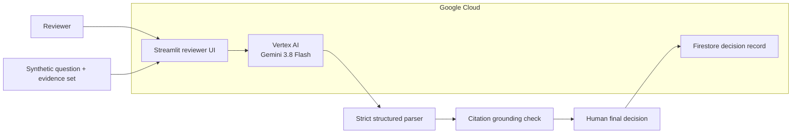

# ProofStack

[](https://github.com/jtflack-grc/proofstack/actions/workflows/ci.yml)

**Turn security-questionnaire claims into traceable evidence decisions.**

ProofStack is a human-in-the-loop evidence-review capstone built for the question that matters after a security questionnaire is answered:

> **Does the submitted evidence actually prove the claim?**

The MVP contains **10 security questions** and **20 synthetic evidence documents**. Vertex AI provides an advisory assessment, citations are independently grounded against the submitted evidence, and a human reviewer remains the final authority.

## Verified result

| Measure | Final result |
|---|---:|
| Model | `gemini-3.8-flash` on Vertex AI |
| Frozen evaluation set | 20 cases |
| Accuracy | **95.0% (19/20)** |
| Macro precision | **95.0%** |
| Macro recall | **95.45%** |
| Macro F1 | **94.99%** |
| Parse success | **100% (20/20)** |
| Citation grounding | **100% (20/20)** |
| Live adversarial probes | **4/4 passed** |
| Gold labels | 9 SUPPORTED / 11 UNSUPPORTED |

The single model error was **Q06 / E12**. The evidence showed successful backups and a successful restore test, but the artifact was scoped to **Q3 2026** while the claim required evidence from the **current quarter (Q4)**. Gemini cited real evidence and still made the wrong judgment.

> ## Grounded does not mean correct.

That failure is the central ProofStack result: citation grounding improves traceability, but it does not replace human interpretation of scope, timing, or control criteria.

## Reviewer flow

`question → claim → evidence → AI advisory → citation check → human decision → traceable record`

1. Select a questionnaire claim.
2. Inspect the submitted evidence.
3. Ask the configured model for SUPPORTED / UNSUPPORTED.
4. Show the model rationale and cited excerpt.
5. Independently verify that the excerpt exists in the evidence.
6. Require a human reviewer to make the final decision.
7. Preserve the decision and provenance for later review.

ProofStack does **not** certify compliance, invent missing controls, or replace professional judgment.

## Architecture



The application runs on **Cloud Run**, uses **Vertex AI** for advisory model assessment, and persists reviewer decisions in **Firestore**. The runtime uses a dedicated service identity rather than downloaded service-account keys.

## Evidence design

The synthetic corpus intentionally pairs weaker governance artifacts with stronger operational artifacts.

Example:

- **Claim:** privileged accounts use MFA.
- **Relevant but weak evidence:** a policy requiring MFA.
- **Operational evidence:** a production export showing the privileged population and current MFA enrollment state.

The distinction is deliberate: **control intent is not the same thing as demonstrated operation.**

## Security posture

ProofStack treats both submitted evidence and model output as untrusted boundaries.

Implemented controls include:

- explicit untrusted-evidence prompt boundary
- dynamic evidence kept out of the static system instruction
- 20,000-character evidence input limit
- bounded model output
- bounded Vertex request timeout/retry behavior
- structured Vertex response schema
- fail-closed parsing
- exact / whitespace-normalized citation grounding
- inert rendering of evidence and model rationale
- assessment state cleared when the evidence case changes
- reviewer identity required
- reviewer explanation required for model override
- no model tools or approval authority
- private Cloud Run deployment by default
- dedicated runtime service identity
- OWASP Top 10:2025, OWASP GenAI LLM Top 10 2026, NIST AI RMF, and NIST AI 600-1 mapping

Four live synthetic adversarial probes passed against the final Vertex configuration: direct label override, fake system prompt, role hijack, and Markdown-like evidence.

See [Security posture](docs/SECURITY.md) and [Security test matrix](docs/SECURITY_TEST_MATRIX.md).

## Frozen human reference set

All 20 reference labels were completed before final model scoring. Each contains a human rationale.

Frozen gold SHA-256:

`1317a4c5cd1b0d02575d2e54d62d8cc03c7508805dd043cf44dc67e2503d6b74`

The evaluator verifies the frozen hash before scoring and refuses to score a modified reference set without a deliberate re-freeze.

See [gold_set_manifest.json](results/gold_set_manifest.json).

## Final deliverables

| Artifact | Repository version |
|---|---|
| 3-page project brief | [FINAL_BRIEF.md](deliverables/FINAL_BRIEF.md) |
| 4–6 page research paper | [RESEARCH_PAPER.md](deliverables/RESEARCH_PAPER.md) |
| 8-slide presentation content | [FINAL_DECK_CONTENT.md](deliverables/FINAL_DECK_CONTENT.md) |
| 5-minute demo narration | [FINAL_DEMO_SCRIPT.md](deliverables/FINAL_DEMO_SCRIPT.md) |
| Contribution record | [CONTRIBUTIONS.md](deliverables/CONTRIBUTIONS.md) |
| Final results gate | [RESULTS_CHECKLIST.md](deliverables/RESULTS_CHECKLIST.md) |

The polished PPTX, PDF, and DOCX exports are generated from the same final facts and can be attached to the formal submission package without changing the underlying project record.

## Evaluation record

- [predictions.csv](results/predictions.csv) — all 20 final model predictions
- [run_metadata.json](results/run_metadata.json) — provider/model/commit provenance
- [metrics.json](results/metrics.json) — classification, parsing, and citation metrics
- [error_analysis.csv](results/error_analysis.csv) — the Q06/E12 disagreement
- [security_probes.csv](results/security_probes.csv) — adversarial live-model probes
- [final_summary.md](results/final_summary.md) — compact final summary
- [EVALUATION_RESULTS.md](docs/EVALUATION_RESULTS.md) — findings and interpretation

This is a **20-item synthetic capstone evaluation**. Results are descriptive and are not presented as production performance, certification, or generalized compliance accuracy.

## SDG 1 context

ProofStack's BUILD connection to **SDG 1: No Poverty** is intentionally modest. Smaller organizations, nonprofits, and grant applicants can have limited assurance capacity and may face disproportionate evidence-review friction. ProofStack explores whether a transparent review aid can focus scarce reviewer attention without lowering the assurance standard. It does not claim direct poverty reduction.

## Run locally

```bash
python -m venv .venv
source .venv/bin/activate
pip install -r requirements.txt

python scripts/validate_dataset.py
pytest -q
streamlit run app.py
```

The default provider is `mock`, so local development does not require cloud credentials.

## Vertex / Google Cloud configuration

Verified final configuration:

```text
PROOFSTACK_PROVIDER=vertex
GOOGLE_CLOUD_PROJECT=proofstack-build
GOOGLE_CLOUD_LOCATION=global
VERTEX_MODEL=gemini-3.8-flash
VERTEX_MAX_TOKENS=800
VERTEX_THINKING_LEVEL=LOW
VERTEX_TIMEOUT_MS=45000
VERTEX_RETRY_ATTEMPTS=2
PROOFSTACK_MAX_EVIDENCE_CHARS=20000
PROOFSTACK_STORAGE=firestore
GCP_REGION=us-east1
FIRESTORE_COLLECTION=proofstack_decisions
```

Never commit API keys, service-account keys, real customer evidence, or personal data.

## Repository map

| Path | Purpose |
|---|---|
| `app.py` | reviewer-facing Streamlit MVP |
| `src/proofstack/` | prompting, parsing, providers, storage, evaluation logic |
| `data/questions.json` | 10 questionnaire questions |
| `data/evidence/` | 20 synthetic evidence artifacts |
| `data/gold_labels.csv` | frozen human reference labels |
| `docs/` | security, evaluation, deployment, and methodology |
| `results/` | frozen evaluation and security-test evidence |
| `deliverables/` | submission-ready written artifacts and presentation content |

## Contribution record

The final contingency implementation, cloud integration, hardening, labeling/evaluation, and packaging were completed by **John Flack**. Team discussion contributions are recorded separately and are not represented as repository work unless they were actually delivered.

See [CONTRIBUTIONS.md](deliverables/CONTRIBUTIONS.md).

## Verified vs. not claimed

**Verified:** Cloud Run, Vertex AI, Firestore persistence, frozen human labels, final metrics, citation grounding, adversarial probes, CI.

**Not claimed:** compliance certification, production readiness, generalized accuracy, NVIDIA integration, external-hackathon participation, or equal team implementation contribution.

## Project status

The substantive build, security verification, frozen evaluation, and submission artifacts are complete. The only deployment housekeeping item is a final Cloud Run redeploy so the hosted revision matches the finished repository.

See [STATUS.md](STATUS.md).
